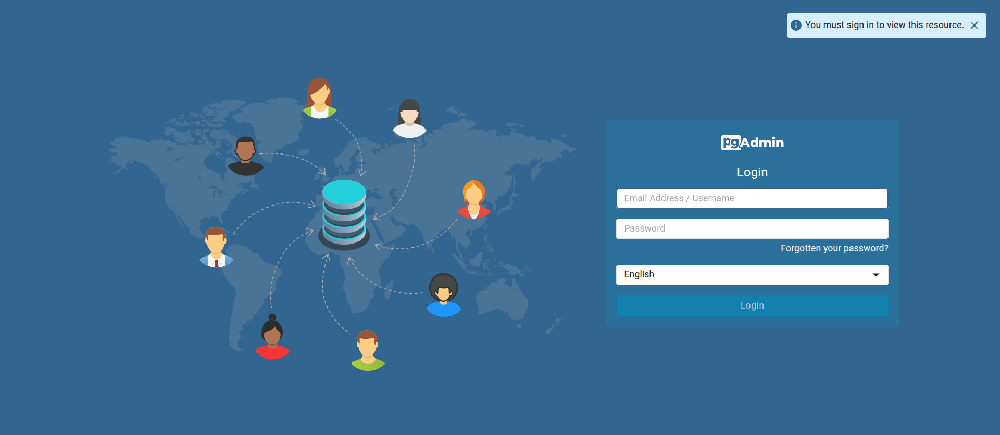
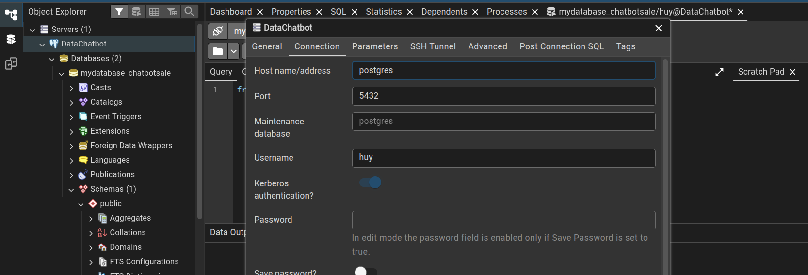
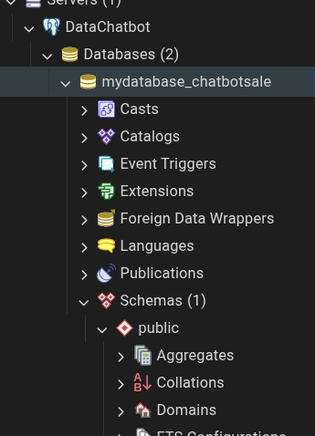
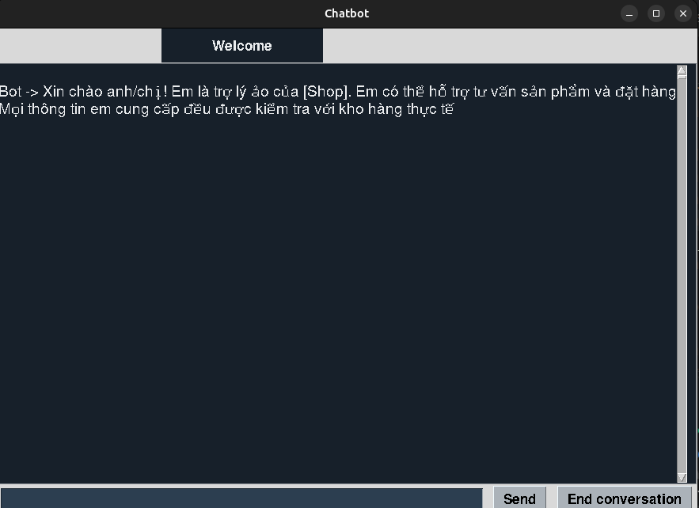
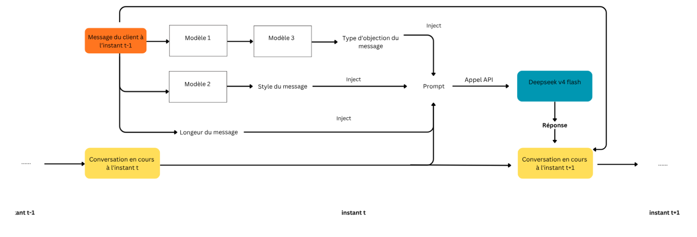
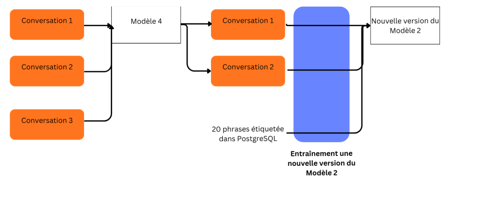

1. Cách vận hành system : 
setup database (chỉ cần làm 1 lần)
- cd vào trong repo self_evolve_chatbot_system
- docker compose up 
- vào http://localhost:5050/ để access pgadmin
- để vào nhập tên đăng nhập : admin@example.com và mật khẩu : 123

- tạo server DataChatBot + database mydatabase_chatbotsale có mật khẩu 123

- tạo schema formal_informal bằng cách copy content của dataset_formal_informal_new.sql vào trong chỗ querry (trong pgadmin vào tools -> querry tool) trong pgadmin và chạy querry 

setup môi trường : 

- chạy python -m venv chatbot để vào python virtual environment
- trong prompting_with_cache.py thay "API_KEY" trong dòng 18 thành api deepseek
- trong up.py trong dòng 75 thay n bằng một số nguyên dương bất kì (xem cơ chế hoạt động của system chatbot)

chạy system :
- trong vscode ở file ui.py chạy bằng nút run
- Để gửi message : viết message trong thành dài phía dưới rồi nhấn "send"
- Muốn kết thúc cuộc trò chuyện bấm "end conversation" thì sẽ quay lại màn hình ban đầu
- Để thoát giao diện bấm "x" ở trên cùng

2. Cơ chế hoạt động của system chatbot

System chatbot hoạt động với 2 cơ chế : 
- Cải thiện cuộc trò chuyện đang diễn ra bằng cách prompt injection objection type, style (formal/informal) của cuộc trò chuyện.

- Cải thiện model sau n cuộc trò chuyện từ những cuộc trò chuyện được stocke  ở trong Postgresql

chú thích : 

modèle 1 : Phát hiện có objection hay không trong message
modèle 2 : Classification  xem message có formal hay không
modèle 3 : classification loại objection của message
modèle 4 : Classification kết quả của conversation bán hàng (thành công/thất bại)

3. Những file và folder chính giúp làm hoạt động system

- ui.py: thành phần cốt lõi của hệ thống, chứa giao diện người dùng (UI) và tích hợp các chức năng chính từ các tập lệnh (script) được mô tả bên dưới; thành phần này tiếp nhận tin nhắn từ phía khách hàng, tạo system prompt (dựa trên mức độ trang trọng, loại phản đối và độ dài của tin nhắn), rồi trả về phản hồi.
- prompting_with_cache.py: xử lý các lệnh gọi API tới mô hình deepseek-v4-flash; hàm "response" trong tập lệnh này nhận tin nhắn từ khách hàng, ngữ cảnh cuộc hội thoại hiện tại và tiền tố (prompt prefix) làm đầu vào để tạo ra phản hồi.
- Objection_detection_classification.py: chứa 2 model (model 1 và 3).*
- style_detection.py và result_of_conversation_classification.py: lần lượt chứa model 2 và model 4.
- improve_model.py: tập trung vào các cải tiến định kỳ đã được đề cập trong kiến ​​trúc hệ thống.

4. Những file và folder quan trọng khác để vận hành system : 
- dataset_formal_informal_new.sql : script sql để import những conversation mới trong database
- docker-compose.yml : file yml để chạy 2 container docker pgadmin và postgresql

- ./chatbot : virtual env python để chạy được chatbot (quản lí python dependencies)
- ./datasets : những dataset tạo ra dùng để train model 
- ./models : folder chứa các model từ 1-4 

5. Những folder phụ ko dùng để vận hành system : 
- ./archive_finding_dataset :  những script dùng trong quá trình tạo dataset training
- ./testing script : folder chứa những script test khác nhau
- ./photos :  ảnh cho vào README.md
.......

